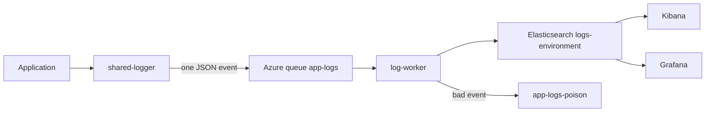
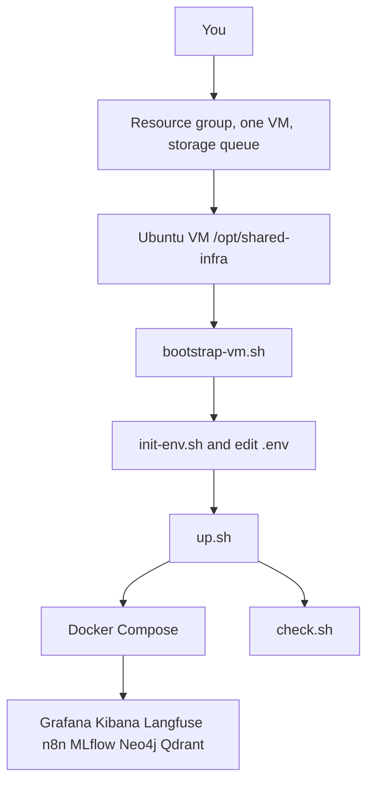
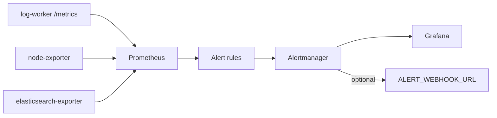
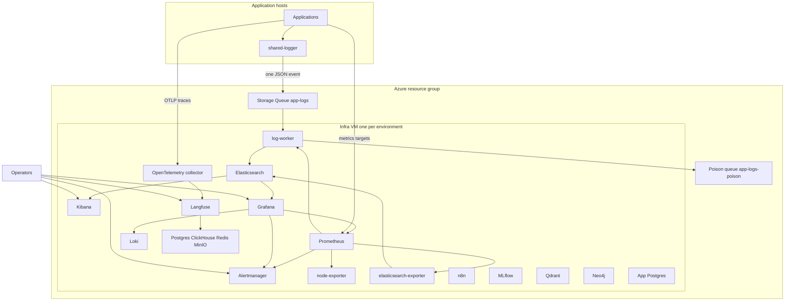

# shared-infra

One Compose project for the shared DevOps hosts. One copy runs on one virtual machine per environment. Applications stay in their own repositories. They log through [shared-logger](https://github.com/SANDESHSALUNKE143/shared-logger) into an Azure Storage Queue. The worker on this VM is the only process that writes those events to Elasticsearch.

n8n is source-available. Read [its license](https://github.com/n8n-io/n8n/blob/master/LICENSE.md) before you host it for other people.

## Where it runs

Create one Azure resource group. Inside it, create one Ubuntu 24.04 virtual machine per environment (`vm-infra-dev`, `vm-infra-staging`, `vm-infra-prod`, or names you prefer). The machine is for this stack only.

- Size: at least 8 vCPU and 32 GiB RAM (`Standard_D8s_v5`). 64 GiB (`Standard_E8s_v5`) is the comfortable size. Langfuse and ClickHouse want about 16 GiB, and Elasticsearch is capped at a 2 GiB heap.
- OS disk: at least 256 GiB.
- On the VM, clone this folder to `/opt/shared-infra`.
- Also create one storage account and a queue named `app-logs` for that environment. The worker creates `app-logs-poison` on startup.

`PUBLIC_HOST` in `.env` is the hostname or IP operators type in a browser. Do not include `http://`.

This folder does not call `az`, Terraform, or Bicep. You create the resource group, the VM, the storage account, and the queue.

## Architecture

Read the pictures in this order. The first is the only path application logs take. The second is what you do on the VM. The third is how a problem becomes an alert. The last picture is every host on that VM.

### Logs

An application calls `shared-logger`. That call puts one JSON event on the storage queue. The worker on the infra VM is the only writer to Elasticsearch. Kibana and Grafana read the indexes. They do not receive logs from the applications.



A good event has `schema_version` 1, a `timestamp`, and an `environment`. The index name is `logs-` plus that environment in lowercase, for example `logs-dev`. The Azure message id is the Elasticsearch document id, so a retry does not create a second copy.

### What you run

You create the Azure pieces. This folder does not. On the VM you generate passwords, start Compose, then open the UIs that have a login.



### Alerts

Prometheus scrapes the hosts on the VM, including the log worker. A rule fires in Alertmanager. Grafana shows the same alerts. A webhook is optional.



Rules cover a target that is down, a log queue deeper than 1000 messages for 10 minutes, a disk past 85 percent full, an Elasticsearch cluster that is yellow or red, indexing that has paused while the queue still has messages, and a spike in poisoned events. `scripts/fire-test-alert.sh` posts one synthetic alert so you can see this path.

### Everything on the VM



Application hosts never open Elasticsearch. They enqueue logs, send traces to the collector on the virtual network, and expose `/metrics` for Prometheus. Operators use Kibana for logs and Grafana for metrics, Loki, and alerts.

## Create the Azure pieces

Network security group:

- SSH from your IP.
- Publish only UIs that have a login, and only to your IP or the virtual network: Grafana `3000`, Kibana `5601`, Langfuse `3003`, n8n `5678`, MLflow `5000`, Neo4j `7474` and `7687`, Qdrant `6333`.
- OpenTelemetry `4317` and `4318` stay on the virtual network. The collector has no login.
- Do not publish Elasticsearch `9200`, Prometheus `9090`, Alertmanager `9093`, Loki `3100`, or the worker. Those bind to `127.0.0.1` on the VM.
- Application VMs do not need a path to Elasticsearch. They need outbound HTTPS to the storage account.
- This VM needs outbound HTTPS to Azure Storage.

## Start it

SSH to the VM, clone this folder to `/opt/shared-infra`, then:

```bash
cd /opt/shared-infra
sudo scripts/bootstrap-vm.sh
scripts/init-env.sh
```

Edit `.env`. Set `ENV_NAME` (for example `dev`), `PUBLIC_HOST` (hostname or IP, no scheme), and `AZURE_STORAGE_CONNECTION_STRING`. Quote the connection string because it contains semicolons:

```bash
AZURE_STORAGE_CONNECTION_STRING='DefaultEndpointsProtocol=https;AccountName=...;AccountKey=...;EndpointSuffix=core.windows.net'
```

Then:

```bash
scripts/up.sh
scripts/check.sh
```

`scripts/up.sh` renders Grafana, Prometheus, Alertmanager, and Loki config from `.env`, then starts Compose. When the connection string is empty it still starts the other services and leaves the log worker off. Prometheus will show that worker down until you set the string and run `scripts/up.sh` again.

`scripts/check.sh` signs in, or hits the ready URL, for each host. When the connection string is set, it enqueues one event, waits until Elasticsearch has it, and deletes that test document.

`docker compose down -v` deletes every named volume. Dashboards, logs, traces, and databases go with it. `docker compose restart` keeps them.

## Accounts and passwords

Usernames are fixed. `scripts/init-env.sh` generates a password per account and writes `.env` with mode `600`. The file is gitignored. `scripts/print-credentials.sh` prints the URL, username, and password on the VM. Do not commit that output.

| Service | User | Password variable |
| --- | --- | --- |
| Grafana | `admin` | `GRAFANA_ADMIN_PASSWORD` |
| Elasticsearch break-glass | `elastic` | `ELASTIC_PASSWORD` |
| Kibana's login to Elasticsearch | `kibana_system` | `KIBANA_SYSTEM_PASSWORD` |
| Log ingest, worker only | `logs_writer` | `LOGS_WRITER_PASSWORD` |
| Log read, Grafana and Kibana | `logs_reader` | `LOGS_READER_PASSWORD` |
| Langfuse | `LANGFUSE_INIT_USER_EMAIL` (`ops@localhost`) | `LANGFUSE_INIT_USER_PASSWORD` |
| Langfuse Postgres | `postgres` | `LANGFUSE_POSTGRES_PASSWORD` |
| ClickHouse | `clickhouse` | `CLICKHOUSE_PASSWORD` |
| Redis | password only | `REDIS_PASSWORD` |
| MinIO | `minio` | `MINIO_ROOT_PASSWORD` |
| MLflow | `admin` | `MLFLOW_ADMIN_PASSWORD` |
| n8n owner | `N8N_OWNER_EMAIL` (`ops@localhost`) | `N8N_OWNER_PASSWORD` |
| Qdrant | API key only | `QDRANT_API_KEY` |
| Neo4j | `neo4j` | `NEO4J_PASSWORD` |
| App Postgres, database `app` | `app` | `SQL_PASSWORD` |

Prometheus, Alertmanager, Loki, the collector, node-exporter, and the worker have no login. Grafana is how you open Prometheus, Loki, Alertmanager, and Elasticsearch. Langfuse also needs `LANGFUSE_NEXTAUTH_SECRET`, `LANGFUSE_SALT`, and `LANGFUSE_ENCRYPTION_KEY`. n8n needs `N8N_ENCRYPTION_KEY`.

After the first Langfuse login, set the project data retention to 30 days in the Langfuse project settings. This Compose file does not set that.

## Use the UIs

Replace the host with `PUBLIC_HOST`.

- Kibana: `http://PUBLIC_HOST:5601`. Data view **Application logs**, index `logs-*`, time field `@timestamp`. Sign in as `logs_reader` or `elastic`.
- Grafana: `http://PUBLIC_HOST:3000`.
- Langfuse: `http://PUBLIC_HOST:3003`.
- n8n: `http://PUBLIC_HOST:5678`.
- MLflow: `http://PUBLIC_HOST:5000`.
- Qdrant: `http://PUBLIC_HOST:6333` with the API key.
- Neo4j Browser: `http://PUBLIC_HOST:7474`. Bolt: `bolt://PUBLIC_HOST:7687`.

From a laptop, tunnel the ports that stay on the VM:

```bash
ssh -L 9090:127.0.0.1:9090 -L 9093:127.0.0.1:9093 -L 3100:127.0.0.1:3100 -L 9200:127.0.0.1:9200 <user>@PUBLIC_HOST
```

Then Prometheus is `http://127.0.0.1:9090`, Alertmanager `http://127.0.0.1:9093`, Loki `http://127.0.0.1:3100`, and Elasticsearch `http://127.0.0.1:9200`. App Postgres listens on `127.0.0.1:5432` on the VM only.

## Send logs from an application

Install the Azure extra and point the logger at the queue. Keep calling `write_info` and the other methods. Do not give the application an Elasticsearch URL.

```bash
pip install "shared-logger[azure]"
```

```bash
SHARED_LOGGER_APPLICATION=api
SHARED_LOGGER_ENVIRONMENT=dev
SHARED_LOGGER_DESTINATION=azure_queue
SHARED_LOGGER_DESTINATION_CONFIG={"queue_name":"app-logs","connection_string_env":"AZURE_STORAGE_CONNECTION_STRING"}
AZURE_STORAGE_CONNECTION_STRING='DefaultEndpointsProtocol=https;AccountName=...;AccountKey=...;EndpointSuffix=core.windows.net'
```

`SHARED_LOGGER_ENVIRONMENT` becomes the index `logs-dev` (lowercase). The message body is one JSON object with `schema_version` 1.

To scrape an application's `/metrics`, add a target to `prometheus/targets.yml` and run `scripts/up.sh` again:

```yaml
- targets: ["10.0.0.10:9000"]
  labels:
    service: api
```

Send traces to `http://PUBLIC_HOST:4318` (HTTP) or port `4317` (gRPC) from a host on the virtual network.

## How a log is parsed

Events are already JSON. Nothing in this stack parses a plain-text line.

The worker accepts an object whose `schema_version` is the number 1, with a `timestamp` string and an `environment` string. It copies `timestamp` to `@timestamp` and uses the Azure message id as the Elasticsearch document id, so a retry replaces the same document. The index is `logs-{environment}`.

`message` is text. `level`, `application`, `environment`, `service_version`, `component`, `cluster`, `region`, `hostname`, and `correlation_id` are keywords. `metadata` and `exception` stay objects. A template cap stops one payload from creating thousands of fields. One shard, zero replicas, refresh every 5 seconds, `best_compression`. An ingest pipeline fills `@timestamp` from `timestamp` if the worker ever skips it.

Invalid JSON, the wrong schema, or a missing timestamp goes to `app-logs-poison` and is removed from `app-logs`. A message that Elasticsearch still rejects after it has been dequeued more than 5 times goes there too.

```bash
scripts/peek-poison.sh
```

That prints up to 32 poison messages and does not delete them.

## Old data

Old data is deleted. It is not copied to Azure Blob first. After the window below, it is gone. The VM disk is the only copy while it exists.

| Data | Default | Variable |
| --- | --- | --- |
| Application logs | delete 30 days after the index is created | `LOG_RETENTION_DAYS` |
| Prometheus | 15 days, or 8 GB, whichever comes first | `PROMETHEUS_RETENTION_TIME`, `PROMETHEUS_RETENTION_SIZE` |
| Loki | 7 days (`168h`). Loki is not the application log store. | `LOKI_RETENTION_PERIOD` |
| n8n executions | 7 days | `N8N_EXECUTIONS_DATA_MAX_AGE` (hours) |
| Langfuse traces | set 30 days in the Langfuse project settings after the first login | — |

Named volumes keep Grafana, Prometheus, Elasticsearch, Loki, Langfuse's stores, n8n, MLflow, Qdrant, Neo4j, and Postgres across restart. `docker compose down -v` deletes that history.

## Performance

These caps leave room for the OS and for Elasticsearch's page cache on a 32 GiB VM. Raising one means lowering another, or moving to 64 GiB.

- Elasticsearch container 4 GiB, heap 2 GiB, memory lock on
- ClickHouse 4 GiB
- Langfuse web 1 GiB and Langfuse worker 1 GiB
- Prometheus 2 GiB, scrape interval 15 seconds
- Kibana 1 GiB, Loki 1 GiB, Neo4j heap 512 MiB plus 256 MiB page cache, Qdrant 1 GiB, n8n 1 GiB
- Grafana, MLflow, each Postgres, MinIO, and the log worker 512 MiB
- Redis 256 MiB with `noeviction`, so Langfuse does not drop queued work
- Every service rotates its own stdout at 10 MiB, three files

The worker pulls up to 32 messages, waits up to 2 seconds to fill that batch, and bulk-indexes. It deletes a message only after Elasticsearch accepts it.

## Security

Elasticsearch security is on. TLS stays off inside the Docker network. The network security group and the passwords are the protection. Do not put these ports on the public internet.

`logs_writer` can create and write `logs-*` and cannot administer the cluster or read other indexes. `logs_reader` can read `logs-*` and open Kibana Discover. Applications do not receive either password.

The storage connection string is an account key in `.env`. To rotate it: create a new key, put it in `.env` on this VM, run `scripts/up.sh`, and set the same value on each application. Managed identity is a later replacement, not this version.

`.env` is mode `600`. Rendered Grafana and Alertmanager files contain a password or a webhook URL. They are gitignored. `scripts/print-credentials.sh` is for the operator on the VM.

## How to scale

This file is one VM, one Elasticsearch node, and one worker. Index replicas stay at 0. Do not start a second copy of Compose against the same volumes. Do not run this stack on every application VM. Application VMs only enqueue.

Grow in this order:

1. Disk or RAM pressure: move to a larger VM, then raise the Elasticsearch heap only after the VM has the memory. The disk alert fires when a filesystem is over 85 percent full.
2. The queue stays deep: `docker compose --env-file .env --profile worker up -d --scale log-worker=2`. The message id is the document id, so two workers can share `app-logs` without duplicating events.
3. Langfuse and Elasticsearch still fight for RAM: move Elasticsearch, Kibana, and the worker to their own VM. Point `ELASTICSEARCH_URL` at that Elasticsearch. Leave Langfuse on the original VM.

A three-node Elasticsearch cluster, Prometheus federation, and a Blob archive before delete are not in this Compose file.

## Alerts

Prometheus loads `prometheus/alerts.yml` and scrapes itself, Alertmanager, node-exporter, the Elasticsearch exporter, the log worker, and `prometheus/targets.yml`.

`scripts/up.sh` renders that file from the Jinja templates in `prometheus/alert-templates`. Three shapes are there to copy: a threshold (`line`), a series that has stopped (`pause`), and a counter rate that jumps above its own baseline (`spike`). The rendered rules are a target down, a log queue deeper than 1000 for 10 minutes, a disk past 85 percent full, Elasticsearch yellow or red, indexing paused while the queue still has messages, and a spike in poisoned events. Those last two are about the `logs-*` indexes: paused means documents are not landing, and poisoned events never become documents.

Every threshold is a key in `.env`, and a missing key keeps the default. The full list, the index template those alerts protect, and what to check when one fires are in [docs/alerts.md](docs/alerts.md).

Set a value, run `scripts/up.sh`, then restart Prometheus so it reads the new file: `docker compose --env-file .env restart prometheus`. The host needs the `python3-jinja2` package, which `scripts/bootstrap-vm.sh` installs.

Firing alerts show in Alertmanager and in Grafana's Alertmanager datasource. Set `ALERT_WEBHOOK_URL` when you have Slack, Teams, or email in front of a webhook, then run `scripts/up.sh` again. Leave it empty and alerts still appear in the UI.

```bash
scripts/fire-test-alert.sh
```

That posts one `TestAlert` so you can see the path without stopping a service.

## Ports and images

Published on the VM, with a login:

| Port | Service | Image |
| --- | --- | --- |
| 3000 | Grafana | `grafana/grafana:11.6.0` |
| 5601 | Kibana | `docker.elastic.co/kibana/kibana:8.17.4` |
| 3003 | Langfuse | `docker.langfuse.com/langfuse/langfuse:4` and `langfuse-worker:4` |
| 5678 | n8n | `n8nio/n8n:1.90.2` |
| 5000 | MLflow | `ghcr.io/mlflow/mlflow:v2.22.0` |
| 7474, 7687 | Neo4j | `neo4j:5.26.4` |
| 6333 | Qdrant | `qdrant/qdrant:v1.13.4` |
| 4317, 4318 | OpenTelemetry collector | `otel/opentelemetry-collector:0.128.0` |

On `127.0.0.1` only:

| Port | Service | Image |
| --- | --- | --- |
| 9090 | Prometheus | `prom/prometheus:v3.2.1` |
| 9093 | Alertmanager | `prom/alertmanager:v0.28.1` |
| 3100 | Loki | `grafana/loki:3.4.2` |
| 9200 | Elasticsearch | `docker.elastic.co/elasticsearch/elasticsearch:8.17.4` |
| 13133 | Collector health | the collector image |
| 5432 | App Postgres | `postgres:16` |

No host port: log worker (this repo's image), node-exporter `prom/node-exporter:v1.8.2`, Elasticsearch exporter `quay.io/prometheuscommunity/elasticsearch-exporter:v1.8.0`, Langfuse Postgres `postgres:17`, ClickHouse `clickhouse/clickhouse-server:25.12`, Redis `redis:7`, MinIO `cgr.dev/chainguard/minio`.

## Layout

- `docker-compose.yml` — every service, memory caps, healthchecks, named volumes
- `log-worker/` — queue consumer, Dockerfile, and unit tests
- `elasticsearch/` — passwords, roles, index template, retention, Kibana data view
- `prometheus/` — scrape config, Jinja alert templates, application targets
- `alertmanager/` — webhook filled from `.env` at start
- `otel/otel-collector.yaml` — OTLP in, Langfuse out
- `grafana/provisioning/` — datasource template
- `docs/alerts.md` — alert settings, the three rule templates, and the `logs-*` index they watch
- `scripts/` — bootstrap, init-env, up, check, print-credentials, peek-poison, fire-test-alert
