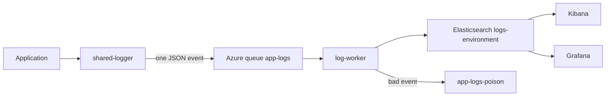
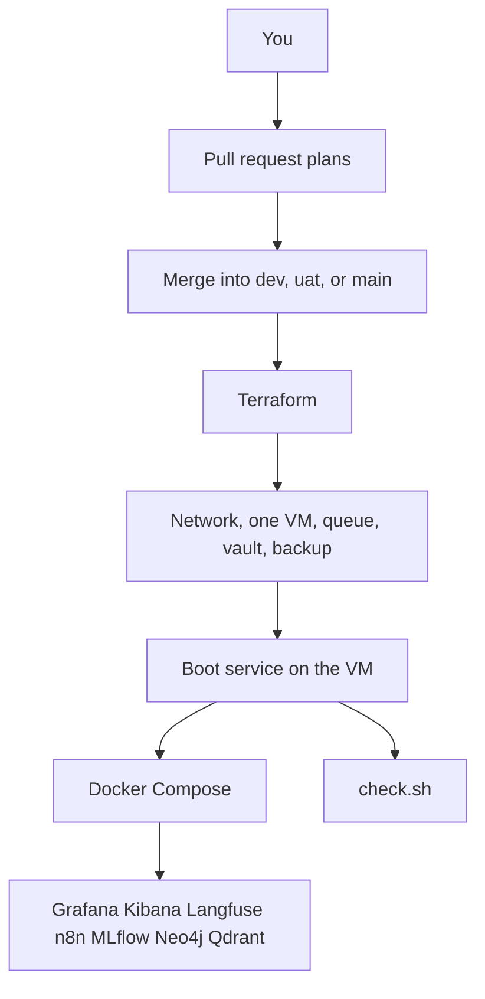
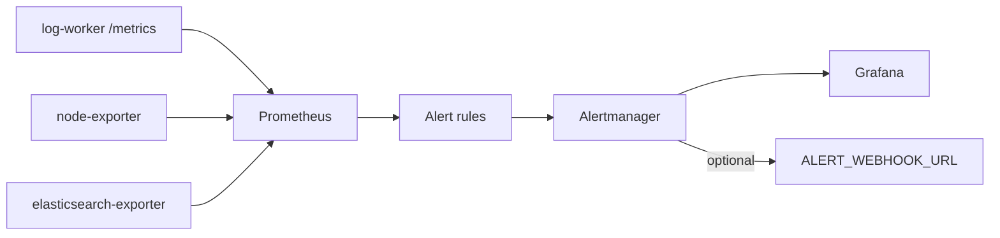
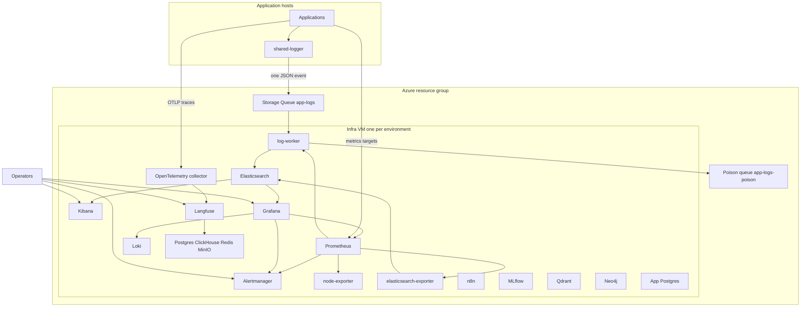

# shared-infra

One Compose project for the shared DevOps hosts. One copy runs on one virtual machine per environment. Applications stay in their own repositories. They log through [shared-logger](https://github.com/SANDESHSALUNKE143/shared-logger) into an Azure Storage Queue. The worker on this VM is the only process that writes those events to Elasticsearch.

n8n is source-available. Read [its license](https://github.com/n8n-io/n8n/blob/master/LICENSE.md) before you host it for other people.

## Where it runs

One Ubuntu 24.04 virtual machine per environment runs this stack. The environments are dev, UAT, and production. Terraform creates the machine and the Azure resources around it: the network, the firewall, the disks, the storage account, the `app-logs` and `app-logs-poison` queues, the registry, Key Vault, backup, alerts, and the night shutdown on dev and UAT.

The only Azure object that already exists is an empty resource group. Its name is in `terraform/environments/<environment>.tfvars`. Terraform does not create that group.

| Environment | Branch | Virtual machine | Size |
| --- | --- | --- | --- |
| dev | `dev` | `vm-infra-dev` | 4 vCPU, 32 GiB |
| uat | `uat` | `vm-infra-uat` | 8 vCPU, 32 GiB |
| prod | `main` | `vm-infra-prod` | 8 vCPU, 64 GiB |

Docker volumes sit on a data disk of 256 GiB (dev), 512 GiB (UAT), or 1024 GiB (production). Elasticsearch stays on a 2 GiB heap. The boot service clones this repo to `/opt/shared-infra`, writes `.env`, and starts Compose. `PUBLIC_HOST` is the virtual machine's public IP, with no `http://`.

The sizes, the monthly budget, and the operator addresses are tfvars. The longer page is [terraform/README.md](terraform/README.md).

## Deploy

Each environment is the same Terraform module and the same Compose file. The differences are the tfvars file and the git branch. Terraform does not create the resource group. Create that empty group first.

```bash
az group create --name rg-shared-infra-dev --location centralindia
```

UAT is `rg-shared-infra-uat`. Production is `rg-shared-infra-prod`. The names live in `terraform/environments/<environment>.tfvars`.

Before the first apply, set `operator_cidrs` to your public address and `alert_email` to a mailbox you read. The firewall allows SSH and the login pages only from `operator_cidrs`. The subscription policy **Deny virtual machines except Kibana** rejects every virtual machine whose name is not on its list, so `vm-infra-dev`, `vm-infra-uat`, and `vm-infra-prod` have to be on that list. Dev, UAT, and production use `Standard_E4s_v3` (4 vCPU, 32 GiB). This subscription has no v5 quota in Central India, and the stack needs 32 GiB. The sign-in password is the same on every environment.

Sign in with the Azure CLI, then run the first apply from a checkout. That apply creates the GitHub app, so it cannot be the GitHub Actions workflow yet.

```bash
export ARM_SUBSCRIPTION_ID=<subscription>
export ARM_TENANT_ID=<tenant>
export ARM_USE_CLI=true
bash terraform/init.sh dev
terraform -chdir=terraform apply -input=false -var-file=environments/dev.tfvars
```

`terraform/init.sh dev` creates the state storage account in the resource group on the first run, then points Terraform at it. Repeat with `uat` or `prod` and that environment's tfvars when you are ready for those environments. Create the `dev` and `uat` branches on GitHub before the virtual machine boots, because cloud-init clones that branch.

After the apply, copy the output `github_client_id` into the GitHub variable `AZURE_CLIENT_ID_DEV`. Also set `AZURE_TENANT_ID` and `AZURE_SUBSCRIPTION_ID`. The next push to `dev` applies through GitHub Actions. UAT follows `uat`, and production follows `main`. The workflow token needs permission to administer GitHub environments. The storage connection string, the registry password, and the SSH private key are in Key Vault either way. Their secret names are `storage-connection-string`, `registry-password`, and `vm-ssh-private-key`.

Cloud-init starts `shared-infra-boot.service`. The service waits for the data disk, formats it once, mounts it at `/var/lib/docker`, installs Docker, clones this repository, reads the storage connection string from Key Vault, and runs `scripts/up.sh`. A Standard public IP is blank in Azure instance metadata, so the boot script uses the address Terraform already created. `scripts/init-env.sh` writes `.env` once, mode `600`, and does not overwrite it. `scripts/up.sh` renders Grafana, Prometheus, Alertmanager, and Loki, then starts Compose.

Dev, UAT, and production run the same module and the same Compose file. The apply prints `public_ip`. The sign-in password below is the same on every environment. There is no standing virtual machine; create one only when you are ready to use that environment.

| Service | URL |
| --- | --- |
| Grafana | `http://PUBLIC_IP:3000` |
| Kibana | `http://PUBLIC_IP:5601` |
| Langfuse | `http://PUBLIC_IP:3003` |
| n8n | `http://PUBLIC_IP:5678` |
| MLflow | `http://PUBLIC_IP:5000` |
| Qdrant | `http://PUBLIC_IP:6333` |
| Neo4j Browser | `http://PUBLIC_IP:7474` |
| Neo4j Bolt | `bolt://PUBLIC_IP:7687` |

Prometheus `9090`, Alertmanager `9093`, Loki `3100`, Elasticsearch `9200`, and app Postgres `5432` listen on `127.0.0.1` on that machine. OpenTelemetry `4317` and `4318` accept traffic from the virtual network. SSH is `ssh azureuser@PUBLIC_IP`.

## Sign-in accounts

The usernames below are the same on every environment. Terraform does not create these passwords. `scripts/init-env.sh` writes them once, the first time the virtual machine boots, into `/opt/shared-infra/.env` with mode `600`. Every sign-in password is the same value:

`SharedInfraDev2026A`

n8n rejects a password with no uppercase letter, and both n8n and Langfuse reject an email on `localhost`. Both owners are `ops@example.com`. Encryption keys (`LANGFUSE_NEXTAUTH_SECRET`, `LANGFUSE_SALT`, `LANGFUSE_ENCRYPTION_KEY`, `N8N_ENCRYPTION_KEY`, `MLFLOW_FLASK_SECRET`) stay random. They are not typed into a login form. The Langfuse project keys keep the `pk-lf-` and `sk-lf-` prefixes and are printed by `scripts/print-credentials.sh`.

Print the passwords for the machine you are on. Do not commit that output. The SSH user is `azureuser`. The private key is the Key Vault secret `vm-ssh-private-key`.

```bash
ssh azureuser@PUBLIC_HOST
cd /opt/shared-infra
scripts/print-credentials.sh
```

Replace `PUBLIC_HOST` with the virtual machine's public IP from the apply output.

| Service | URL | User | Password variable | A working sign-in |
| --- | --- | --- | --- | --- |
| Grafana | `http://PUBLIC_HOST:3000` | `admin` | `GRAFANA_ADMIN_PASSWORD` | The Grafana home page, not the login form |
| Kibana | `http://PUBLIC_HOST:5601` | `logs_reader` | `LOGS_READER_PASSWORD` | Elastic home. Data view **Application logs**, index `logs-*`, time field `@timestamp` |
| Kibana break-glass | `http://PUBLIC_HOST:5601` | `elastic` | `ELASTIC_PASSWORD` | Same Kibana home, with cluster admin |
| Langfuse | `http://PUBLIC_HOST:3003` | `ops@example.com` | `LANGFUSE_INIT_USER_PASSWORD` | The Langfuse project **Shared Infra** |
| n8n | `http://PUBLIC_HOST:5678` | `ops@example.com` | `N8N_OWNER_PASSWORD` | The workflow list |
| MLflow | `http://PUBLIC_HOST:5000` | `admin` | `MLFLOW_ADMIN_PASSWORD` | The browser basic-auth prompt, then the MLflow UI. The experiment list includes **Default** |
| Qdrant | `http://PUBLIC_HOST:6333` | none | `QDRANT_API_KEY` | Send header `api-key`. The collections URL returns JSON |
| Neo4j Browser | `http://PUBLIC_HOST:7474` | `neo4j` | `NEO4J_PASSWORD` | Connect URL `neo4j://PUBLIC_HOST:7687`. The connect form is the page before you sign in |
| App Postgres | `127.0.0.1:5432` on the VM | `app` | `SQL_PASSWORD` | Database `app`. `pg_isready -U app -d app` accepts connections |
| Elasticsearch | `http://127.0.0.1:9200` on the VM | `elastic` | `ELASTIC_PASSWORD` | HTTP 200 with the cluster name. Without a password the same URL returns 401 |
| Elasticsearch writer | not published | `logs_writer` | `LOGS_WRITER_PASSWORD` | Used only by the log worker |
| Elasticsearch for Kibana | not published | `kibana_system` | `KIBANA_SYSTEM_PASSWORD` | Used only by the Kibana container |
| Langfuse Postgres | not published | `postgres` | `LANGFUSE_POSTGRES_PASSWORD` | Database `postgres` on the `langfuse-postgres` container |
| ClickHouse | not published | `clickhouse` | `CLICKHOUSE_PASSWORD` | Used by Langfuse |
| Redis | not published | none | `REDIS_PASSWORD` | Used by Langfuse |
| MinIO | not published | `minio` | `MINIO_ROOT_PASSWORD` | Used by Langfuse for event and media storage |
| Langfuse project | API | public key `pk-lf-…` | `LANGFUSE_INIT_PROJECT_SECRET_KEY` (`sk-lf-…`) | `LANGFUSE_INIT_PROJECT_PUBLIC_KEY` is the public half |

Prometheus (`127.0.0.1:9090`), Alertmanager (`127.0.0.1:9093`), Loki (`127.0.0.1:3100`), the OpenTelemetry collector (`4317`, `4318`, and `127.0.0.1:13133`), node-exporter, and the log worker have no login. Open them through an SSH tunnel, or open Prometheus, Loki, and Alertmanager from Grafana. The collector accepts traces from the virtual network only.

Langfuse also stores `LANGFUSE_NEXTAUTH_SECRET`, `LANGFUSE_SALT`, and `LANGFUSE_ENCRYPTION_KEY`. n8n stores `N8N_ENCRYPTION_KEY`. MLflow stores `MLFLOW_FLASK_SECRET`. Those are not sign-in passwords. The login pages are HTTP, so n8n runs with `N8N_SECURE_COOKIE=false`. After the first Langfuse login, set the project data retention to 30 days in the Langfuse project settings. This Compose file does not set that.

`scripts/check.sh` signs in with these same accounts. A passing run is the confirmation that the passwords in `.env` match the running services.

## Architecture

Read the pictures in this order. The first is the only path application logs take. The second is what you do on the VM. The third is how a problem becomes an alert. The last picture is every host on that VM.

### Logs

An application calls `shared-logger`. That call puts one JSON event on the storage queue. The worker on the infra VM is the only writer to Elasticsearch. Kibana and Grafana read the indexes. They do not receive logs from the applications.



A good event has `schema_version` 1, a `timestamp`, and an `environment`. The index name is `logs-` plus that environment in lowercase, for example `logs-dev`. The Azure message id is the Elasticsearch document id, so a retry does not create a second copy.

### What you run

Terraform creates the Azure resources. The boot service on the virtual machine writes the sign-in password from `scripts/init-env.sh`, starts Compose, and the UIs that have a login come up.



### Alerts

Prometheus scrapes the hosts on the VM, including the log worker. A rule fires in Alertmanager. Grafana shows the same alerts. A webhook is optional.



Rules cover a target that is down, a log queue deeper than 1000 messages for 10 minutes, a disk past 85 percent full, an Elasticsearch cluster that is yellow or red, indexing that has paused while the queue still has messages, and a spike in poisoned events. `scripts/fire-test-alert.sh` posts one synthetic alert so you can see this path.

### Everything on the VM



Application hosts never open Elasticsearch. They enqueue logs, send traces to the collector on the virtual network, and expose `/metrics` for Prometheus. Operators use Kibana for logs and Grafana for metrics, Loki, and alerts.

## Ports

Terraform's network security group is the firewall on the virtual machine.

- SSH from `operator_cidrs` in the tfvars file.
- These UIs, from those same addresses and from the virtual network: Grafana `3000`, Kibana `5601`, Langfuse `3003`, n8n `5678`, MLflow `5000`, Neo4j `7474` and `7687`, Qdrant `6333`.
- OpenTelemetry `4317` and `4318` from the virtual network. The collector has no login.
- Elasticsearch `9200`, Prometheus `9090`, Alertmanager `9093`, Loki `3100`, and the worker stay off the security group. They bind to `127.0.0.1` on the VM.
- Application hosts reach the storage account over HTTPS. They do not open Elasticsearch.
- This VM reaches Azure Storage and Key Vault over HTTPS.

## Start it

The boot service installs Docker, fills `ENV_NAME`, `PUBLIC_HOST`, and `AZURE_STORAGE_CONNECTION_STRING`, and runs `scripts/up.sh`. SSH when you want the passwords or a check. The private key is the Key Vault secret `vm-ssh-private-key` and the GitHub environment secret `VM_SSH_PRIVATE_KEY`.

```bash
ssh azureuser@PUBLIC_HOST
cd /opt/shared-infra
scripts/print-credentials.sh
scripts/check.sh
```

Edit `.env` when you want a webhook or a different retention value, then run `scripts/up.sh` again. Quote the connection string because it contains semicolons.

`scripts/up.sh` renders Grafana, Prometheus, Alertmanager, and Loki config from `.env`, then starts Compose. When the connection string is empty it still starts the other services and leaves the log worker off. Prometheus will show that worker down until the string is set and you run `scripts/up.sh` again.

`scripts/check.sh` signs in, or hits the ready URL, for each host. When the connection string is set, it enqueues one event, waits until Elasticsearch has it, and deletes that test document.

`docker compose down -v` deletes every named volume. Dashboards, logs, traces, and databases go with it. `docker compose restart` keeps them.

## Use the UIs

Replace the host with `PUBLIC_HOST`.

- Kibana: `http://PUBLIC_HOST:5601`. Data view **Application logs**, index `logs-*`, time field `@timestamp`. Sign in as `logs_reader` or `elastic`.
- Grafana: `http://PUBLIC_HOST:3000`.
- Langfuse: `http://PUBLIC_HOST:3003`.
- n8n: `http://PUBLIC_HOST:5678`.
- MLflow: `http://PUBLIC_HOST:5000`.
- Qdrant: `http://PUBLIC_HOST:6333` with the API key.
- Neo4j Browser: `http://PUBLIC_HOST:7474`. Bolt: `bolt://PUBLIC_HOST:7687`.

From a laptop, tunnel the ports that stay on the VM:

```bash
ssh -L 9090:127.0.0.1:9090 -L 9093:127.0.0.1:9093 -L 3100:127.0.0.1:3100 -L 9200:127.0.0.1:9200 <user>@PUBLIC_HOST
```

Then Prometheus is `http://127.0.0.1:9090`, Alertmanager `http://127.0.0.1:9093`, Loki `http://127.0.0.1:3100`, and Elasticsearch `http://127.0.0.1:9200`. App Postgres listens on `127.0.0.1:5432` on the VM only.

## Send logs from an application

Install the Azure extra and point the logger at the queue. Keep calling `write_info` and the other methods. Do not give the application an Elasticsearch URL.

```bash
pip install "shared-logger[azure]"
```

```bash
SHARED_LOGGER_APPLICATION=api
SHARED_LOGGER_ENVIRONMENT=dev
SHARED_LOGGER_DESTINATION=azure_queue
SHARED_LOGGER_DESTINATION_CONFIG={"queue_name":"app-logs","connection_string_env":"AZURE_STORAGE_CONNECTION_STRING"}
AZURE_STORAGE_CONNECTION_STRING='DefaultEndpointsProtocol=https;AccountName=...;AccountKey=...;EndpointSuffix=core.windows.net'
```

`SHARED_LOGGER_ENVIRONMENT` becomes the index `logs-dev` (lowercase). The message body is one JSON object with `schema_version` 1.

To scrape an application's `/metrics`, add a target to `prometheus/targets.yml` and run `scripts/up.sh` again:

```yaml
- targets: ["10.0.0.10:9000"]
  labels:
    service: api
```

Send traces to `http://PUBLIC_HOST:4318` (HTTP) or port `4317` (gRPC) from a host on the virtual network.

## How a log is parsed

Events are already JSON. Nothing in this stack parses a plain-text line.

The worker accepts an object whose `schema_version` is the number 1, with a `timestamp` string and an `environment` string. It copies `timestamp` to `@timestamp` and uses the Azure message id as the Elasticsearch document id, so a retry replaces the same document. The index is `logs-{environment}`.

`message` is text. `level`, `application`, `environment`, `service_version`, `component`, `cluster`, `region`, `hostname`, and `correlation_id` are keywords. `metadata` and `exception` stay objects. A template cap stops one payload from creating thousands of fields. One shard, zero replicas, refresh every 5 seconds, `best_compression`. An ingest pipeline fills `@timestamp` from `timestamp` if the worker ever skips it.

Invalid JSON, the wrong schema, or a missing timestamp goes to `app-logs-poison` and is removed from `app-logs`. A message that Elasticsearch still rejects after it has been dequeued more than 5 times goes there too.

```bash
scripts/peek-poison.sh
```

That prints up to 32 poison messages and does not delete them.

## Old data

Old data is deleted. It is not copied to Azure Blob first. After the window below, it is gone. The VM disk is the only copy while it exists.

| Data | Default | Variable |
| --- | --- | --- |
| Application logs | delete 30 days after the index is created | `LOG_RETENTION_DAYS` |
| Prometheus | 15 days, or 8 GB, whichever comes first | `PROMETHEUS_RETENTION_TIME`, `PROMETHEUS_RETENTION_SIZE` |
| Loki | 7 days (`168h`). Loki is not the application log store. | `LOKI_RETENTION_PERIOD` |
| n8n executions | 7 days | `N8N_EXECUTIONS_DATA_MAX_AGE` (hours) |
| Langfuse traces | set 30 days in the Langfuse project settings after the first login | — |

Named volumes keep Grafana, Prometheus, Elasticsearch, Loki, Langfuse's stores, n8n, MLflow, Qdrant, Neo4j, and Postgres across restart. `docker compose down -v` deletes that history.

## Performance

These caps leave room for the OS and for Elasticsearch's page cache on a 32 GiB VM. Raising one means lowering another, or moving to 64 GiB.

- Elasticsearch container 4 GiB, heap 2 GiB, memory lock on
- ClickHouse 4 GiB
- Langfuse web 1 GiB and Langfuse worker 1 GiB
- Prometheus 2 GiB, scrape interval 15 seconds
- Kibana 1 GiB, Loki 1 GiB, Neo4j heap 512 MiB plus 256 MiB page cache, Qdrant 1 GiB, n8n 1 GiB
- Grafana, MLflow, each Postgres, MinIO, and the log worker 512 MiB
- Redis 256 MiB with `noeviction`, so Langfuse does not drop queued work
- Every service rotates its own stdout at 10 MiB, three files

The worker pulls up to 32 messages, waits up to 2 seconds to fill that batch, and bulk-indexes. It deletes a message only after Elasticsearch accepts it.

## Security

Elasticsearch security is on. TLS stays off inside the Docker network. The network security group and the passwords are the protection. Do not put these ports on the public internet.

`logs_writer` can create and write `logs-*` and cannot administer the cluster or read other indexes. `logs_reader` can read `logs-*` and open Kibana Discover. Applications do not receive either password.

The storage connection string is an account key. Terraform stores it in Key Vault and in the GitHub environment secret `AZURE_STORAGE_CONNECTION_STRING`. The boot service writes it into `.env`. To rotate it: rotate the storage key, apply this environment so the secret updates, restart the boot service, and set the same value on each application. The worker still uses that connection string.

`.env` is mode `600`. Rendered Grafana and Alertmanager files contain a password or a webhook URL. They are gitignored. `scripts/print-credentials.sh` is for the operator on the VM.

## How to scale

This file is one VM, one Elasticsearch node, and one worker. Index replicas stay at 0. Do not start a second copy of Compose against the same volumes. Do not run this stack on every application VM. Application VMs only enqueue.

Grow in this order:

1. Disk or RAM pressure: move to a larger VM, then raise the Elasticsearch heap only after the VM has the memory. The disk alert fires when a filesystem is over 85 percent full.
2. The queue stays deep: `docker compose --env-file .env --profile worker up -d --scale log-worker=2`. The message id is the document id, so two workers can share `app-logs` without duplicating events.
3. Langfuse and Elasticsearch still fight for RAM: move Elasticsearch, Kibana, and the worker to their own VM. Point `ELASTICSEARCH_URL` at that Elasticsearch. Leave Langfuse on the original VM.

A three-node Elasticsearch cluster, Prometheus federation, and a Blob archive before delete are not in this Compose file.

## Alerts

Prometheus loads `prometheus/alerts.yml` and scrapes itself, Alertmanager, node-exporter, the Elasticsearch exporter, the log worker, and `prometheus/targets.yml`.

`scripts/up.sh` renders that file from the Jinja templates in `prometheus/alert-templates`. Three shapes are there to copy: a threshold (`line`), a series that has stopped (`pause`), and a counter rate that jumps above its own baseline (`spike`). The rendered rules are a target down, a log queue deeper than 1000 for 10 minutes, a disk past 85 percent full, Elasticsearch yellow or red, indexing paused while the queue still has messages, and a spike in poisoned events. Those last two are about the `logs-*` indexes: paused means documents are not landing, and poisoned events never become documents.

Every threshold is a key in `.env`, and a missing key keeps the default. The full list, the index template those alerts protect, and what to check when one fires are in [docs/alerts.md](docs/alerts.md).

Set a value, run `scripts/up.sh`, then restart Prometheus so it reads the new file: `docker compose --env-file .env restart prometheus`. The host needs the `python3-jinja2` package, which `scripts/bootstrap-vm.sh` installs.

Firing alerts show in Alertmanager and in Grafana's Alertmanager datasource. Set `ALERT_WEBHOOK_URL` when you have Slack, Teams, or email in front of a webhook, then run `scripts/up.sh` again. Leave it empty and alerts still appear in the UI.

```bash
scripts/fire-test-alert.sh
```

That posts one `TestAlert` so you can see the path without stopping a service.

## Ports and images

Published on the VM, with a login:

| Port | Service | Image |
| --- | --- | --- |
| 3000 | Grafana | `grafana/grafana:11.6.0` |
| 5601 | Kibana | `docker.elastic.co/kibana/kibana:8.17.4` |
| 3003 | Langfuse | `docker.langfuse.com/langfuse/langfuse:4` and `langfuse-worker:4` |
| 5678 | n8n | `n8nio/n8n:1.90.2` |
| 5000 | MLflow | `shared-infra-mlflow:local`, built from `ghcr.io/mlflow/mlflow:v2.22.0` with the auth extra |
| 7474, 7687 | Neo4j | `neo4j:5.26.4` |
| 6333 | Qdrant | `qdrant/qdrant:v1.13.4` |
| 4317, 4318 | OpenTelemetry collector | `otel/opentelemetry-collector:0.128.0` |

On `127.0.0.1` only:

| Port | Service | Image |
| --- | --- | --- |
| 9090 | Prometheus | `prom/prometheus:v3.2.1` |
| 9093 | Alertmanager | `prom/alertmanager:v0.28.1` |
| 3100 | Loki | `grafana/loki:3.4.2` |
| 9200 | Elasticsearch | `docker.elastic.co/elasticsearch/elasticsearch:8.17.4` |
| 13133 | Collector health | the collector image |
| 5432 | App Postgres | `postgres:16` |

No host port: log worker (this repo's image), node-exporter `prom/node-exporter:v1.8.2`, Elasticsearch exporter `quay.io/prometheuscommunity/elasticsearch-exporter:v1.8.0`, Langfuse Postgres `postgres:17`, ClickHouse `clickhouse/clickhouse-server:25.12`, Redis `redis:7`, MinIO `cgr.dev/chainguard/minio`.

## Layout

- `docker-compose.yml` — every service, memory caps, healthchecks, named volumes
- `log-worker/` — queue consumer, Dockerfile, and unit tests
- `elasticsearch/` — passwords, roles, index template, retention, Kibana data view
- `prometheus/` — scrape config, Jinja alert templates, application targets
- `alertmanager/` — webhook filled from `.env` at start
- `otel/otel-collector.yaml` — OTLP in, Langfuse out
- `grafana/provisioning/` — datasource template
- `docs/alerts.md` — alert settings, the three rule templates, and the `logs-*` index they watch
- `terraform/` — dev, UAT, and production. One virtual machine per environment
- `scripts/` — bootstrap, init-env, up, check, print-credentials, peek-poison, fire-test-alert
